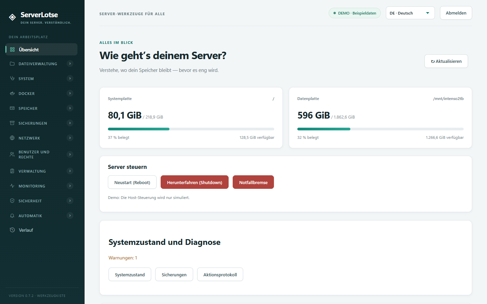
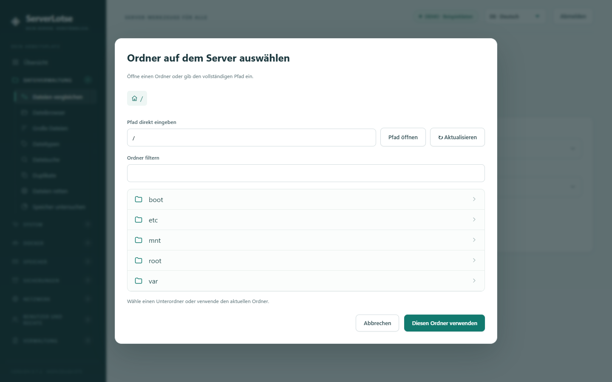
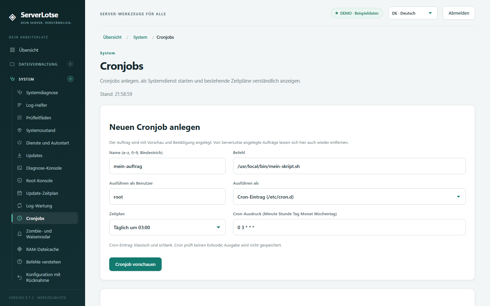
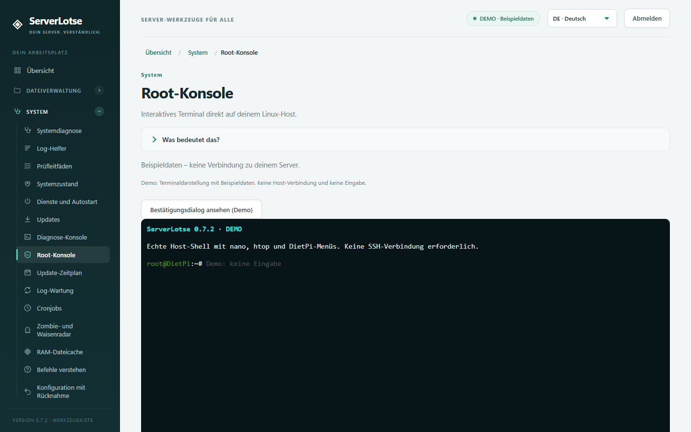
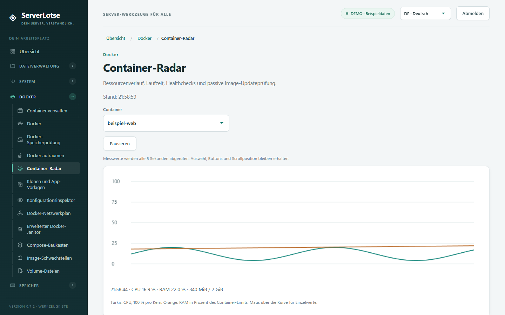
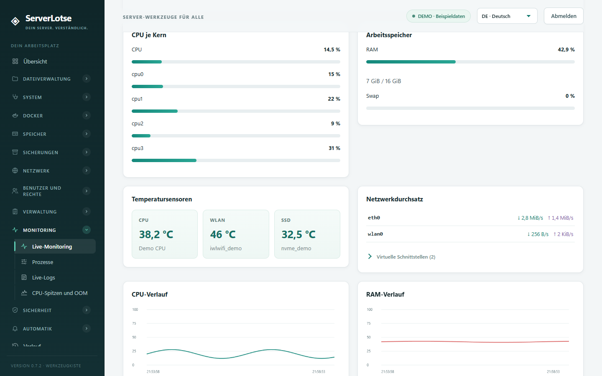
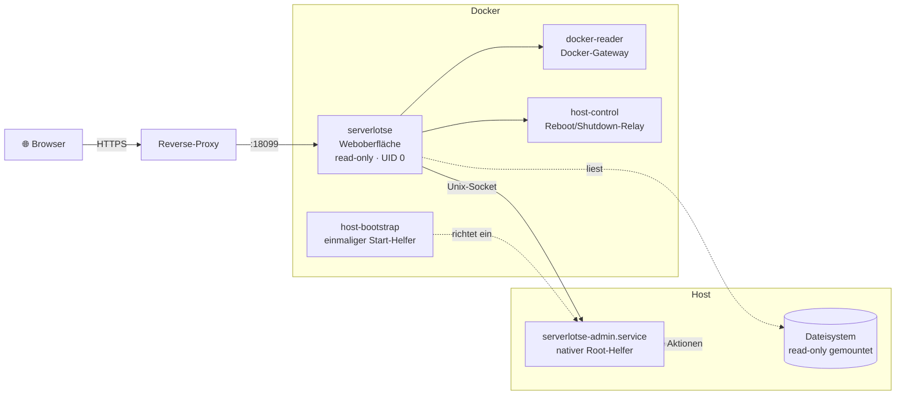

<div align="center">

# ◈ ServerLotse

### Dein Server. Verständlich.

**Eine selbst gehostete Weboberfläche, die deinen Linux-Homeserver erklärt, überwacht und sicher verwaltet –<br>mit Vorschau vor jeder Änderung und ganz ohne Cloud.**


[✨ Funktionen](#-funktionen) · [🚀 Schnellstart](#-schnellstart) · [🛡️ Sicherheit](#%EF%B8%8F-sicherheitsmodell) · [🏗️ Architektur](#%EF%B8%8F-architektur) · [🧪 Entwicklung](#-entwicklung--tests)



</div>

---

## 💡 Warum ServerLotse?

Ein Homeserver wächst schnell: Docker-Container, Festplatten, Backups, Proxy, Cronjobs, Firewall. Wer nicht täglich in der Shell lebt, verliert den Überblick. ServerLotse bündelt rund **70 Werkzeuge in 11 Kategorien** in einer ruhigen, verständlichen Oberfläche:

| | |
|---|---|
| 🔍 **Erst verstehen** | Jede Seite erklärt in Alltagssprache, was sie zeigt („Was bedeutet das?“). |
| 👀 **Dann prüfen** | Jede Änderung zeigt vorher eine **Vorschau** mit Warnungen. |
| ✅ **Dann bestätigen** | Ausgeführt wird nur nach ausdrücklicher Bestätigung (`AUSFUEHREN`, `LOESCHEN`, `ROOT` …). |
| 📜 **Nachvollziehen** | Jede Aktion landet dauerhaft im Aktionsprotokoll. |

> [!NOTE]
> **Keine Cloud, keine Telemetrie, keine Fremdpakete.** Reines Python-Standardbibliothek-Backend, Vanilla-JavaScript-Frontend, keine CDN-Abhängigkeiten, strikte Content-Security-Policy. Läuft komplett auf deiner Hardware – getestet mit Blick auf DietPi / Debian.

---

## ✨ Funktionen

<details open>
<summary><b>📁 Dateiverwaltung</b> – Speicher verstehen und Daten retten</summary>

| Werkzeug | Was es tut |
|---|---|
| 🥧 **Speicher untersuchen** | Zeigt, welche Ordner wie viel Platz belegen – auch Daten, die *unter* Einhängepunkten versteckt liegen. |
| ⇄ **Dateien vergleichen** | Prüft per SHA-256, ob alle Dateien einer Quelle inhaltsgleich im Ziel vorhanden sind (ideal nach Umzügen und Backups). |
| 📂 **Dateibrowser** | Ordner, Dateigrößen, Eigentümer und Rechte ansehen. |
| 📊 **Große Dateien** | Die 200 größten Dateien eines Ordners – ohne feste Eintragsgrenze dank temporärem SQLite-Index. |
| 🏷️ **Dateitypen** | Speicher nach Endungen aufschlüsseln: Videos, Archive, Bilder und mehr. |
| 🔎 **Dateisuche** | Nach Namen suchen, `*` und `?` als Platzhalter. |
| 👯 **Duplikate** | Inhaltsgleiche Dateien finden (SHA-256). |
| 🛟 **Dateien retten** | Geprüfte Kopien in einen separaten Rettungsordner – Originale bleiben unangetastet. |

Ein gemeinsamer **Ordnerdialog** mit Pfad-Breadcrumbs, direkter Pfadeingabe und Filter ersetzt überall lange Dropdowns.


</details>

<details open>
<summary><b>🩺 System</b> – Diagnose, Dienste, Wartung</summary>

| Werkzeug | Was es tut |
|---|---|
| 🩺 **Systemdiagnose** & ❤️ **Systemzustand** | Laufzeit, Last, Fehler und Warnungen auf einen Blick. |
| 📄 **Log-Helfer** | Protokolltexte einfügen und verständlich auswerten lassen. |
| ☑️ **Prüfleitfäden** | Schritt-für-Schritt-Checklisten für typische Probleme. |
| ⏻ **Dienste und Autostart** | systemd-Dienste starten, stoppen, (de)aktivieren; Zugangsdienste sind geschützt. |
| ⬇️ **Updates** & 📅 **Update-Zeitplan** | APT-Updates installieren, nächtliche Sicherheitsupdates via `unattended-upgrades` – ohne automatischen Neustart. |
| 💻 **Diagnose-Konsole** | Vordefinierte, rein lesende Diagnosebefehle. |
| 🖥️ **Root-Konsole** | Echtes interaktives Host-Terminal (xterm.js): `nano`, `htop`, DietPi-Menüs, Tab, Strg+C, Vollbild – **ohne SSH-Key**. |
| 🔄 **Log-Wartung** | Große Logs finden und vorhandene logrotate-Richtlinien vorzeitig ausführen. |
| ⏰ **Cronjobs** | Bestehende Cron-Einträge und systemd-Timer verständlich anzeigen – und **neue Cronjobs anlegen**, wahlweise als Cron-Eintrag oder als **Systemdienst mit Timer**, optional sofort starten. |
| 👻 **Zombie- und Waisenradar** | Beendete Prozesse erklären, verwaiste Docker-Prozesse gezielt beenden. |
| 🧠 **RAM-Dateicache** | Wiederherstellbare Caches bei Bedarf einmalig freigeben. |
| ❓ **Befehle verstehen** | `rm`, `chmod`, `chown` erklären lassen, *bevor* du sie ausführst. |
| ↩️ **Konfiguration mit Rücknahme** | Nginx/SSH bearbeiten – ohne Bestätigung nach 30 Sekunden automatisch zurückgerollt. |
| 📦 **Paket-Wartung** | Unbenutzte Pakete entfernen; Kernel-, Zugangs- und Systempakete sind gesperrt. |


<br><br>

</details>

<details>
<summary><b>🐳 Docker</b> – Container verwalten, beobachten, aufräumen</summary>

| Werkzeug | Was es tut |
|---|---|
| 📦 **Container verwalten** | Start, Stop, Neustart, Logs und Ressourcen je Container. |
| 🐳 **Docker** | Überblick über Images, Volumes und Netzwerke. |
| 💽 **Docker-Speicherprüfung** | Nicht referenzierte Volumes und *dangling* Images finden. |
| 🧹 **Docker aufräumen** | Alte Images und Build-Cache bereinigen; einzelne Volumes nur mit `LOESCHEN`. |
| 📡 **Container-Radar** | CPU/RAM-Verlauf, Healthchecks, Neustarts, OOM und passive Image-Updateprüfung – aktualisiert Werte live alle 5 Sekunden, ohne die Seite neu aufzubauen. |
| 🧬 **Klonen und App-Vorlagen** | Container-Konfiguration klonen; Vorlagen für Nginx, WordPress, Nextcloud. |
| 👁️ **Konfigurationsinspektor** | Env-Variablen und Configs mit automatisch maskierten Geheimnissen. |
| 🕸️ **Docker-Netzwerkplan** | Filterbare Karte, welcher Container in welchem Netz hängt. |
| 🗑️ **Erweiterter Janitor** | Gestoppte Container, ungenutzte Images/Netzwerke/Volumes gezielt entfernen. |
| 🧱 **Compose-Baukasten** | Eigene App-Projekte per Formular erstellen und später bearbeiten. |
| 🐞 **Image-Schwachstellen** | Lokale Images mit dem offiziellen Trivy-Scanner isoliert prüfen. |
| 📝 **Volume-Dateien** | Kleine Textdateien in Docker-Volumes durchsuchen und mit Sicherung bearbeiten. |


</details>

<details>
<summary><b>💾 Speicher</b> – Laufwerke und Gesundheit</summary>

| Werkzeug | Was es tut |
|---|---|
| 🖴 **Laufwerke** | Festplatten, SMART-Werte, Mount/Unmount. |
| 🔌 **Datenträger-Zuordnung** | Welches Gerät hängt wo – über UUIDs, robust gegen wechselnde Gerätenamen. |
| 🔋 **SSD-Verschleiß** | Vorsichtige Auswertung der SMART-Endurance-Werte. |
| #️⃣ **Inode-Radar** | Freie Dateieinträge prüfen – plus optionaler Belegungswächter. |
</details>

<details>
<summary><b>🗄️ Sicherungen</b> – Backups, die man auch zurückspielen kann</summary>

| Werkzeug | Was es tut |
|---|---|
| 🗄️ **Sicherungen** | `.tar.gz`-Dateisicherungen planen, Inhalt prüfen, separat wiederherstellen. |
| 🛢️ **Datenbank- und Remote-Backup** | Optionale MySQL/MariaDB-Exporte, Upload per **SFTP** oder **S3**; lokale Kopie bleibt bei Uploadfehlern erhalten. |
| ☁️ **Remote-Profile** | Getrennte, root-geschützte Zugangsprofile; bestehende rclone-Dienste bleiben unverändert. |
| ✅ **Datenbank-Testrestore** | Echter SQL-Import in einem isolierten Wegwerf-Container ohne Netzwerk – so weißt du, dass dein Backup funktioniert. |
</details>

<details>
<summary><b>🌐 Netzwerk</b> – Proxy, TLS, DNS</summary>

| Werkzeug | Was es tut |
|---|---|
| 🌐 **Netzwerk** | Adressen, offene Ports, DNS und Erreichbarkeit vom Server aus prüfen. |
| 🧩 **Proxy-Vorlagen** & 🔀 **Proxy einrichten** | Natives **Caddy** oder **Nginx + Certbot** mit öffentlichem Zertifikat, ACME-Zustimmung und Rücknahmepfad. Nginx Proxy Manager bleibt unberührt. |
| 📶 **Web und Bandbreite** | HTTP-Erreichbarkeit und (manuelle/geplante) Speedtests. |
| 🔁 **Dynamisches DNS** | Opt-in DDNS für **Cloudflare**, **Namecheap** und **GoDaddy**. |
| 🪧 **Domain zum Container** | DNS prüfen und eine Domain per Proxy auf einen Container leiten. |
</details>

<details>
<summary><b>👥 Benutzer, Rechte & Verwaltung</b></summary>

| Werkzeug | Was es tut |
|---|---|
| 👥 **Benutzer und Gruppen** | Anlegen, Gruppen zuordnen, Passwörter setzen. |
| 🔒 **Dateirechte** | Eigentümer und Rechte gezielt ändern – mit Checkbox-Raster statt Oktalzahlen. |
| 📋 **Aktionsprotokoll** | Dauerhafter Verlauf aller Änderungen, als JSON exportierbar. |
</details>

<details>
<summary><b>📈 Monitoring</b> – live und mit Verlauf</summary>

| Werkzeug | Was es tut |
|---|---|
| 📈 **Live-Monitoring** | CPU je Kern, RAM/Swap, Temperatur-Kacheln, Netzwerkdurchsatz mit automatischen Einheiten (B/s → MiB/s), virtuelle Schnittstellen aufklappbar, eine Stunde Verlauf. |
| 🎚️ **Prozesse** | Sortierbare Prozessliste mit gezielten Prozessaktionen. |
| 📜 **Live-Logs** | Mitlaufendes Journal mit Filter und Pause. |
| 📉 **CPU-Spitzen und OOM** | Unabhängige Stichproben und bestätigte Out-of-Memory-Ereignisse. |


</details>

<details>
<summary><b>🛡️ Sicherheit</b> – prüfen statt hoffen</summary>

| Werkzeug | Was es tut |
|---|---|
| 🔑 **SSH-Prüfung** | Riskante sshd-Einstellungen erkennen. |
| 🛡️ **Firewall-Status** & 🧱 **Firewall-Regeln** | UFW / iptables / nftables lesen, UFW-Portregeln bestätigt setzen. |
| 🚫 **fail2ban** | Jails und gesperrte Adressen ansehen. |
| 🖥️ **Anmeldesitzungen** | Aktive Logins und Terminal-Sitzungen, gezielt beenden. |
| 📜 **Zertifikats-Countdown** | Ablaufdaten deiner TLS-Zertifikate. |
| 🛑 **Notfallbremse** | 60-Sekunden-Netzsperre mit IP-Ausnahmen und automatischer Freigabe. |
| 🔀 **Firewall und Datenwege** | Listener, Docker-Ports und tatsächliche Regeln gemeinsam darstellen. |
</details>

<details>
<summary><b>🔔 Automatik</b> – nur, wenn du sie einschaltest</summary>

| Werkzeug | Was es tut |
|---|---|
| 🔔 **Automatik und Meldungen** | CPU-/RAM-/SSH-Warnungen per **Discord**, **Telegram** oder HTTPS-Webhook, mit Grenzwerten und Sendepausen. |
| 🔧 **Auto-Heiler** | Ausgewählte Dienste/Container nach Fehlern neu starten – mit Grenzen und manueller Sperre. |
| 👁️ **Datei- und Dienstwächter** | FIM-Vergleichsbasis für wichtige Dateien und Dienstzustände. |

> Alle Automatiken sind bei der Erstinstallation **ausgeschaltet**. Es wird nichts nach außen gesendet, bis du ein Ziel konfigurierst und bestätigst.
</details>

### 🎨 Oberfläche

- 🧭 **Breadcrumbs** (Übersicht › Kategorie › Werkzeug) und eigene Kategorieseiten
- 🌳 Seitenleiste als Baumstruktur mit eigenem Icon-Set und animierten Aufklapp-Chips
- ⏳ Laufende Aktionen werden überall mit Spinner hervorgehoben
- 🌍 Deutsch, Englisch, Spanisch – umschaltbar zur Laufzeit
- 📱 Responsiv bis Smartphone-Breite

---

## 🚀 Schnellstart

### Voraussetzungen

- 🐧 Linux-Host mit **systemd** und **Python 3.9+** (z. B. DietPi, Debian, Ubuntu)
- 🐳 **rootful Docker** mit **Compose-Plugin**
- 🔐 Empfohlen: ein HTTPS-Reverse-Proxy (z. B. Nginx Proxy Manager) vor der Oberfläche

Optionale Hostwerkzeuge werden je Funktion erkannt und bei Bedarf zur Installation angeboten: `smartmontools`, `acl`, `ufw`, `nftables`, `unattended-upgrades`, `rclone`, `caddy` / `nginx` + `certbot`.

### Installation

```bash
# 1. Projekt auf den Server kopieren
unzip ServerLotse-0.7.4.zip -d /mnt/daten/serverlotse
cd /mnt/daten/serverlotse

# 2. Konfiguration anlegen
cp .env.example .env
openssl rand -hex 32   # Ausgabe als SERVERLOTSE_TOKEN in .env eintragen

# 3. Starten
docker compose up -d --build
```

Danach ist ServerLotse unter `http://127.0.0.1:18099` erreichbar – idealerweise über deinen HTTPS-Proxy. Anmelden mit dem Token aus der `.env`.

> [!TIP]
> Der einmalige Start-Helfer richtet den nativen Root-Dienst und die Systemansicht **automatisch** ein. Kein manueller Installer, keine zusätzliche Portfreigabe.

### ⚙️ Konfiguration (`.env`)

| Variable | Standard | Bedeutung |
|---|---|---|
| `SERVERLOTSE_TOKEN` | – | **Pflicht.** Zugangsschlüssel, mindestens 24 Zeichen. |
| `SERVERLOTSE_BIND` | `127.0.0.1` | IP, an die Port `18099` gebunden wird. |
| `DATA_PATHS` | `/mnt/intenso2tb` | Datenpfade für die Übersicht. |
| `SESSION_COOKIE_SECURE` | `1` | Sichere Cookies; `0` nur für private HTTP-Tests. |
| `HOST_CONTROL_ENABLED` | `1` | Neustart/Herunterfahren über das interne Relay. |
| `RECOVERY_PATH` | – | Optionaler Rettungsordner (nur mit `compose.recovery.yaml`). |

Rettungskopien aktivieren:

```bash
docker compose -f compose.yaml -f compose.recovery.yaml up -d --build
```

### 🔄 Update

Neue Version über die Projektdateien kopieren, **eigene `.env` behalten**, dann:

```bash
docker compose up -d --build
```

Anschließend im Browser `Strg + F5`. Details: [UPDATE.md](UPDATE.md)

---

## 🛡️ Sicherheitsmodell

ServerLotse ist ein mächtiges Werkzeug – **wer den Token hat, hat Root auf dem Host.** Deshalb gilt:

| Schutzmaßnahme | Umsetzung |
|---|---|
| 🔐 **Authentifizierung** | Token + signierte Sitzungscookies, optional „angemeldet bleiben“. |
| 👀 **Vorschau-Pflicht** | Jede strukturierte Änderung erzeugt eine 120 s gültige Einmalvorschau; der Zustand wird vor Ausführung erneut geprüft. |
| ✍️ **Bestätigungswörter** | `AUSFUEHREN`, `LOESCHEN` für endgültige Löschungen, `ROOT` fürs Terminal, `REBOOT`/`SHUTDOWN` mit 60 s Freigabe. |
| 🧱 **Container-Härtung** | Read-only-Dateisystem, `cap_drop: ALL` + nur `DAC_READ_SEARCH`, `no-new-privileges`, PID-/RAM-/CPU-Limits. |
| 📖 **Host nur lesend** | Host- und Systemeinbindungen sind **read-only**; Änderungen laufen ausschließlich über den lokalen Root-Helfer. |
| 🔌 **Kein Zusatzport** | Der Root-Helfer spricht nur über einen authentifizierten Unix-Socket. |
| 🙈 **Geheimnisfilter** | Passwörter/Tokens werden in Vorschau, Protokoll und Inspektor maskiert. |
| 🧾 **Strikte CSP** | `default-src 'self'`, keine Inline-Skripte, keine externen Ressourcen. |
| ↩️ **Rücknahmepfade** | Konfigurationsänderungen mit Auto-Rollback, Notfallbremse mit Auto-Freigabe. |

> [!WARNING]
> Die Root-Konsole kann alle Schutzgrenzen umgehen. Betreibe ServerLotse **nur hinter HTTPS**, schütze den Token wie ein Root-Passwort und führe keine Befehle aus, deren Wirkung du nicht verstehst. Es gibt keine getrennten Benutzerrollen und kein externes Sicherheitsaudit.

---

## 🏗️ Architektur



| Komponente | Aufgabe |
|---|---|
| **serverlotse** | Python-HTTP-Server + statische Oberfläche; liest Host-Dateien read-only, Scan-Index im eigenen Volume `scan-cache`. |
| **docker-reader** | Kapselt den Docker-Zugriff in einem eigenen Netz. |
| **host-control** | Authentifiziertes Relay für Neustart und Herunterfahren. |
| **host-bootstrap** | Einmaliger privilegierter Helfer (Host-PID + `nsenter`), installiert/aktualisiert den nativen Dienst und endet mit Exitcode 0. |
| **serverlotse-admin.service** | Nativer Root-Dienst, führt nur feste, validierte Operationen nach bestätigter Vorschau aus. |

### 📂 Projektstruktur

```text
serverlotse/
├── server.py              # HTTP-Server, Auth, API, statische Dateien
├── admin_core.py          # Vorschau, Bestätigung, Protokoll, Basisverwaltung
├── admin_agent.py         # nativer Root-Helfer (Unix-Socket)
├── workbench.py           # Dispatcher der Werkstatt-Werkzeuge
├── expert_tools.py        # Cronjobs, APT, Notfallbremse, Rücknahme …
├── docker_tools.py        # Radar, Klonen, Inspektor, Janitor
├── network_extras.py      # DDNS, Domain, Inode-Wächter
├── scan_index.py          # temporärer SQLite-Scanindex
├── static/                # Oberfläche (Vanilla JS, CSS, Icons, Übersetzungen)
├── tests/                 # 200+ Unit-Tests, ohne echte Hostaktionen
├── compose.yaml           # Standard-Deployment
└── compose.recovery.yaml  # optionaler Rettungsordner
```

---

## 🧪 Entwicklung & Tests

```bash
# Unit-Tests (Host- und Netzwerkaufrufe sind simuliert)
python -m unittest discover -s tests -v

# Tests im Container
docker build -f Dockerfile.test -t serverlotse-tests .
docker run --rm serverlotse-tests

# Demo mit Beispieldaten – alle Hostaktionen gesperrt
SERVERLOTSE_DEMO=1 python server.py   # → http://127.0.0.1:8099
```

> [!IMPORTANT]
> Die Tests ersetzen echte Hostbefehle und externe Übertragungen. Die vollständige Linux-, Docker-, Proxy- und Remote-Integration ist **noch nicht umfassend auf echter Hardware getestet**. Neue Funktionen zuerst mit entbehrlichen Testdaten ausprobieren.

### ⚠️ Bekannte Grenzen

- Sicherungen sind keine atomaren Snapshots von Datenbank und Dateien; SQL wird bei der Wiederherstellung als Datei abgelegt, nicht automatisch importiert.
- Backups und Zugangsdaten sind nicht zusätzlich verschlüsselt.
- Große Scans brauchen freien Plattenplatz für den temporären Index; Ergebnislisten bleiben begrenzt.
- Proxys nicht parallel auf belegten Ports installieren; Nginx Proxy Manager wird nicht verändert.


---

## 📄 Lizenz

Veröffentlicht unter der [MIT-Lizenz](LICENSE). Mitgeliefert: [xterm.js](https://xtermjs.org/) 6.0.0 und addon-fit 0.11.0 (MIT), siehe [`static/vendor/VENDOR.md`](static/vendor/VENDOR.md).

<div align="center">
<br>

**◈ Für deinen Homeserver gebaut. Erst verstehen, dann entscheiden.**

</div>
